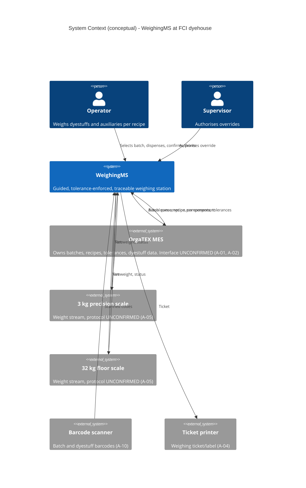
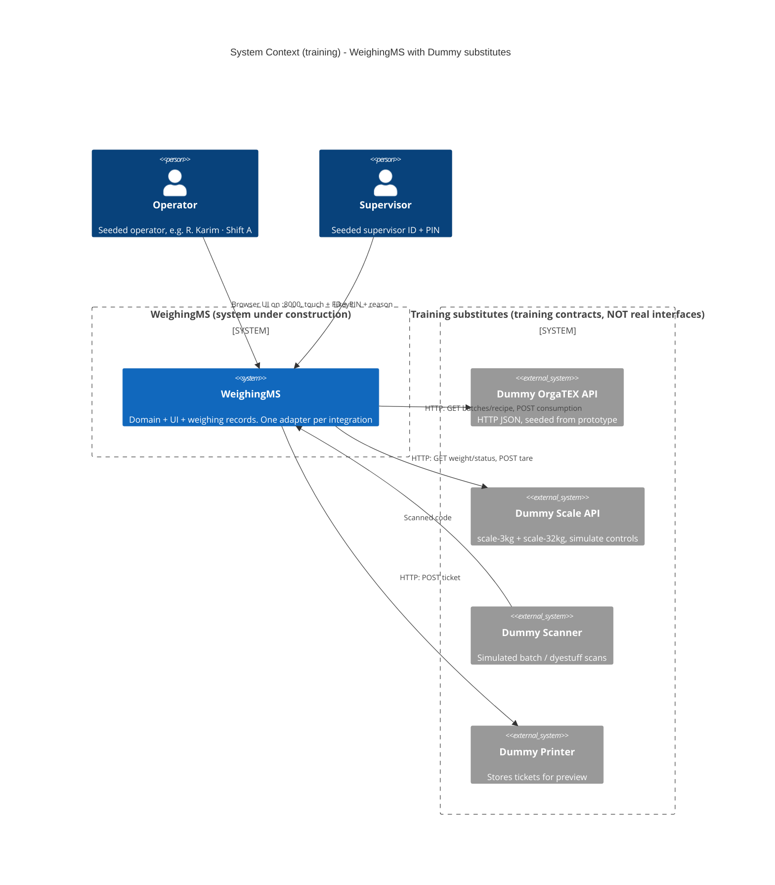

# Assisted Dyestuff Weighing Station (WeighingMS) - System Context

> **Status: approved 2026-11-20T04:17:25Z (`APPROVE SYSTEM CONTEXT`). Brief IR-06 (batch status write-back) confirmed not built.**
>
> **How to read this file.** It has two layers that must not be confused:
> - **Conceptual (real) context**: the FCI dyehouse as described in `docs/brief.md`. The real OrgaTEX, scales, scanner and printer, and every interface detail about them, are **unconfirmed** (brief §12, A-01…A-15). Nothing here resolves them.
> - **Training (dummy) context**: what this build actually talks to. The Dummy OrgaTEX API, Dummy Scale API, Dummy Scanner and Dummy Printer are **training contracts defined by this project**. They are **not** the real interfaces and make no claim about them.

## System Overview

WeighingMS is a single operator station (one station, one site; NFR-3) in FCI's dyehouse. It sits between OrgaTEX MES and the weighing operator: it receives the batch queue and recipe, picks the scale per component, guides dispensing against live weight, refuses out-of-tolerance confirmation, records every confirmed weighing, posts actual consumption back, and prints a weighing ticket. It never authors recipes (C-01), never modifies OrgaTEX (C-02) and never controls dispensing machinery (C-03).

In the training build every external party is replaced by a Dummy reachable **only over HTTP** through one adapter per integration (FR-21, IR-07, DB-10), so a real integration can later replace a Dummy without touching domain logic.

## Actors

| Actor | Type | Role in the context | Source |
|---|---|---|---|
| **Operator** | Human, primary | Identified at session start (training: chosen from a seeded list, e.g. "R. Karim · Shift A", OQ-3). Selects a batch (scan or touch), scans dyestuff, tares, dispenses, confirms (F1), re-tares (F2), quits (F4), prints (F1) and moves to the next batch (F3). | brief §4; FR-2, FR-4, FR-7, FR-13, FR-18, FR-19 |
| **Supervisor** | Human, privileged | Authorises an override when the weight is over tolerance. Training: seeded supervisor ID + PIN + reason, recorded (OQ-3). Exact overshoot behaviour is decided at workbook STEP 24 (OQ-4, open). | brief FR-35, FR-36, NFR-12; FR-14; NFR-4 |

Lab/QA and store/inventory are secondary beneficiaries of the records (brief §4). They do not interact with the station in this build (OQ-2: no reporting beyond retrieving a batch's records, FR-19c).

## Systems and Devices: Real Concept vs Training Substitute

| Real conceptual party (brief) | What it is in the real dyehouse | Training substitute (this build) | What the substitute is |
|---|---|---|---|
| **WeighingMS** | The system being built | **WeighingMS** (same) | Django app: domain logic, UI (Django templates + Alpine.js), weighing records in SQLite |
| **OrgaTEX** (SETEX MES) | Master of batches, recipes, tolerances, dyestuff data; receiver of consumption. Interface technology unknown (A-01, A-02; brief §10.1 shape is "illustrative, for FCI/SETEX to correct") | **Dummy OrgaTEX API** | HTTP JSON training contract, seeded from the prototype (B-24187 "Teal 4C" + queued B-24188/90/91). Can be switched to unavailable (DB-1…DB-4) |
| **Scale** ×2 (3 kg precision, 32 kg floor) | Physical scale indicators streaming weight, protocol unknown (A-05, A-06) | **Dummy Scale API** | HTTP training contract for two scales returning net weight, unit, status. Weight is driven by simulate controls (dispense, overshoot, reset, set exact weight). Tare command. Can be switched to disconnected (DB-5…DB-7) |
| **Scanner** | Wireless barcode scanner, keyboard-wedge or serial (IR-15, A-10) | **Dummy Scanner** | Simulated scans of a batch barcode or a dyestuff code. Can be switched to unavailable (DB-8) |
| **Printer** | Ticket/label printer, layout set by FCI (IR-16, A-04) | **Dummy Printer** | Accepts a ticket, stores it, returns it for preview. Can be switched to error (DB-9) |

## Context Diagrams

### A. Conceptual context (real systems, unconfirmed interfaces)

### B. Training context (what this build actually integrates with)

## Data Flows

### Inbound (into WeighingMS)

| From | Data | Format (training) | Validation by WeighingMS | Source |
|---|---|---|---|---|
| Operator | Operator identity, batch selection (touch), Confirm / Re-tare / Quit / Print / Next | UI events, F-keys | Operator must be identified before weighing; confirm re-checked server-side | FR-2, FR-13, FR-19, NFR-9 |
| Supervisor | Supervisor ID + PIN + reason for override | Form | Must match a seeded supervisor; recorded | OQ-3, FR-14 |
| OrgaTEX → *Dummy OrgaTEX* | Batch queue (batch, order, machine, fabric/lot, shade, component count, status), batch details | JSON over HTTP | Unknown batch → "Batch not found"; non-selectable → reason shown | FR-1, FR-2, OQ-5 |
| OrgaTEX → *Dummy OrgaTEX* | Recipe + components in sequence: code, name, colour, target, unit, tolerance, display max, lot, container, tare | JSON over HTTP | Quantities parsed as `Decimal`; missing recipe → weighing does not start | FR-3, FR-5, FR-6, FR-7, FR-10, FR-12, OQ-7 |
| Scale → *Dummy Scale* | Current net weight, unit, status (ready / disconnected) per scale | JSON over HTTP, polled ≥ 5 Hz | `Decimal`; disconnected → confirm blocked | FR-9, FR-20, NFR-1 |
| Scanner → *Dummy Scanner* | Batch barcode or dyestuff code | Simulated scan | Batch must exist; dyestuff code must match active component, else "Wrong dyestuff" | FR-2, FR-4, OQ-8 |
| Printer → *Dummy Printer* | Print result (ok / error), stored ticket for preview | JSON over HTTP | Error never shown as printed | FR-18, FR-20 |

### Outbound (from WeighingMS)

| To | Data | Guarantee | Source |
|---|---|---|---|
| OrgaTEX ← *Dummy OrgaTEX* | Actual consumption per component for a completed batch | Idempotent (retry does not double-post); "CONFIRMED" shown only after acceptance; on failure records stay in WeighingMS and retry is offered | FR-17, IR-05, IR-08 |
| Scale ← *Dummy Scale* | Tare command (net zero) for the selected scale | Re-tare restarts the component's weighing | FR-7 |
| Printer ← *Dummy Printer* | Weighing ticket: header, batch, order, machine, shade, date/time, operator, per-component target/actual/unit, tolerance summary, batch barcode; reprint marked "REPRINT" | Failure reported; can print again later | FR-18 |
| Operator (UI) | Queue, recipe rail, live weight, target / now / left, tolerance band and zone, scale "automatic", surplus panel, completion summary, device status bar | Data comes from the Dummy APIs, never hard-coded | FR-1…FR-16, FR-20, FR-21 |

**Not an outbound flow in this build:** brief IR-06 (update OrgaTEX batch weighing status) is not among the approved FRs, so it is not built. Offline sync (OQ-1) and reporting (OQ-2) are also out of scope.

## Ownership

| Data | Owner (master) | WeighingMS role | Training holder | Source |
|---|---|---|---|---|
| Batch header, queue, scheduling | OrgaTEX | Read only | Dummy OrgaTEX seed | brief §9.3, C-01 |
| Recipe, components, targets, tolerances | OrgaTEX | Read only, no editing; target and tolerance snapshotted onto the weighing record | Dummy OrgaTEX seed | C-01, FR-3, FR-10, FR-12 |
| Dyestuff identity / code | OrgaTEX | Read; verified by scan | Dummy OrgaTEX seed | FR-4 |
| Dyestuff lot, container, tare value | Unresolved for real product (Q28, Q29, A-09) | Read and recorded | Dummy OrgaTEX seed per component (OQ-7) | FR-5, FR-6, FR-7 |
| Scale selection threshold (3 kg) and station/device config | WeighingMS | Master, configurable without code change | WeighingMS settings | FR-8, NFR-13 |
| Operator and supervisor identities | WeighingMS (or FCI directory, A-09) | Master | WeighingMS seed (OQ-3) | FR-19, NFR-4 |
| Weighing records, overrides, (later) compensations | WeighingMS | Master, immutable; corrections are new records | WeighingMS DB | NFR-5, NFR-12, FR-13 |
| Actual consumption | OrgaTEX (receiver) | Posts it | Dummy OrgaTEX stores consumption | FR-17, brief §9.3 |
| Live weight, scale status | Scale | Read only | Dummy Scale state | FR-9 |
| Printed ticket | Printer (physical output) | Generates content | Dummy Printer stores ticket | FR-18 |

WeighingMS never becomes a second source of truth for anything OrgaTEX owns (C-01).

## Integration Boundaries

1. **One adapter per integration.** WeighingMS domain code calls an OrgaTEX adapter, a Scale adapter, a Scanner adapter and a Printer adapter. Only the adapters know the Dummy HTTP contracts. Replacing a Dummy with a real system changes only its adapter (IR-07, FR-21).
2. **HTTP only.** The Dummies live in their own Django app(s) and tables. WeighingMS domain code never imports Dummy models or reads Dummy tables; it reaches them only over HTTP (DB-10, FR-21b).
3. **UI boundary.** Templates and JS contain no batch, recipe or component data. The UI gets everything from WeighingMS, which gets it from the Dummies (FR-21a).
4. **Training contracts (minimum, per workbook STEP 16; exact shapes fixed during Construction):**
   - Dummy OrgaTEX: `GET /api/batches`, `GET /api/batches/:batchId`, `GET /api/batches/:batchId/recipe`, `POST /api/batches/:batchId/consumption`
   - Dummy Scale: `GET /api/scales`, `GET /api/scales/:scaleId/status`, `GET /api/scales/:scaleId/weight`, `POST /api/scales/:scaleId/tare`, plus training-only simulate controls (DB-6)
   - Dummy Printer: `POST /api/tickets`
   - Dummy Scanner: simulated scan input (shape defined with the Units)
   - Every Dummy: a training-only failure toggle (DB-4, DB-7, DB-8, DB-9)

   These are **training contracts, not claims about the real OrgaTEX, scale, scanner or printer interfaces.** The brief's §10.1 endpoint shape is not adopted.
5. **Not crossed.** No connection to dispensing machinery (C-03), no write to recipes (C-01), no change to OrgaTEX (C-02), no real device drivers.

## Clarification (STEP 12, user decision 2026-11-20T05:15:14Z)

Decided by the user while planning Bolts, because workbook STEP 19, 21, 26 and 27 expect the browser's Network tab to show the Dummy API calls (`GET /api/batches`, `GET /api/batches/B-24187/recipe`, `GET /api/scales/scale-3kg/weight`, `POST /api/batches/B-24187/consumption`, `POST /api/tickets`):

- The **browser UI calls the Dummy APIs directly**, through **one JS client module per integration** (OrgaTEX, Scale, Scanner, Printer). No other JS file knows those paths (FR-21: the UI obtains data "only from the Dummy APIs over HTTP").
- The **WeighingMS server stays the authority**: it snapshots the selected recipe and re-reads the scale through its own Python adapters (one per integration) before accepting a confirmation, stores all records, and supplies the consumption payload + idempotency key and the ticket content. The browser reports write-back and print results back to the server, which records them.
- Integration boundary 1 ("one adapter per integration") therefore applies per runtime: one JS client and, where the server needs it, one Python adapter per integration. Domain code still never imports Dummy models.

## Failure Boundaries

Rule: a failure stays inside the party that failed, is shown to the operator, and is **never shown as success** (NFR-7). Confirmed records are never lost because of an external failure.

| Failure (training toggle) | Effect at the boundary | What stays safe | Source |
|---|---|---|---|
| Dummy OrgaTEX unavailable: reading queue/recipe | "OrgaTEX unavailable" instead of an empty or stale list; weighing does not start | No stale data shown as current | FR-1c, FR-3d |
| Dummy OrgaTEX unavailable: consumption post | Write-back shown as "not written" with retry; never "CONFIRMED" | Weighing records stay in WeighingMS; retry is idempotent | FR-17d, IR-08 |
| Dummy Scale disconnected | Status bar shows scale not ready; live weight unavailable; confirm blocked within 2 s | No confirmation without a live weight | FR-20a, IR-13 |
| Dummy Scanner unavailable | Scan shows an error and changes nothing; batch can still be chosen by touch | Confirm stays blocked until dyestuff identity is verified | FR-20b, FR-4 |
| Dummy Printer error | "Print ticket" reports failure; nothing marked printed; can print later | Completed batch and its records unaffected | FR-20c, FR-18d |
| Out-of-tolerance weight (domain, not device) | Confirm disabled in UI **and** rejected server-side | Nothing over or under tolerance is recorded; overshoot handling waits for STEP 24 (OQ-4) | FR-12, FR-13b, FR-14 |
| Page reload / restart mid-batch | Batch reopens at the in-progress component | Prior confirmations kept (single DB transaction per confirm) | NFR-5, NFR-6 |

## High-Level Constraints

- Approved stack (`memory-bank/standards/`): Python 3.12, Django, SQLite, Django templates + Alpine.js, `Decimal` quantities, UTC timestamps.
- C-01 recipes owned by OrgaTEX; C-02 no OrgaTEX modification; C-03 no dispensing-machine control; C-05 low computer literacy; C-06 scale capacities bound what can be weighed.
- Dummy APIs are training contracts and must be replaceable without touching domain logic.
- All brief §12 assumptions (A-01…A-15) and FCI-level questions stay unresolved.

## Key NFR Goals

- Live weight refresh ≤ 200 ms (NFR-1); recipe shown ≤ 3 s (NFR-2).
- Confirmed weighing durable before the UI advances; resume after reload (NFR-5, NFR-6).
- Fail-safe devices: no failure shown as success (NFR-7).
- Immutable records (NFR-12); configurable scale threshold (NFR-13).
- Prototype fidelity, ≥ 15 mm touch targets, F-keys, English UI (NFR-8…NFR-11).
